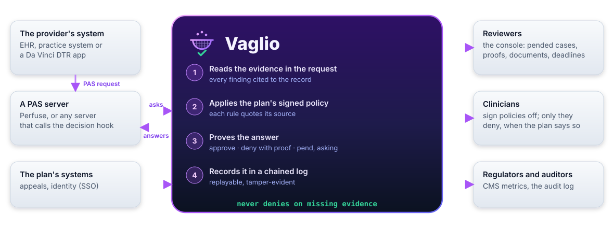
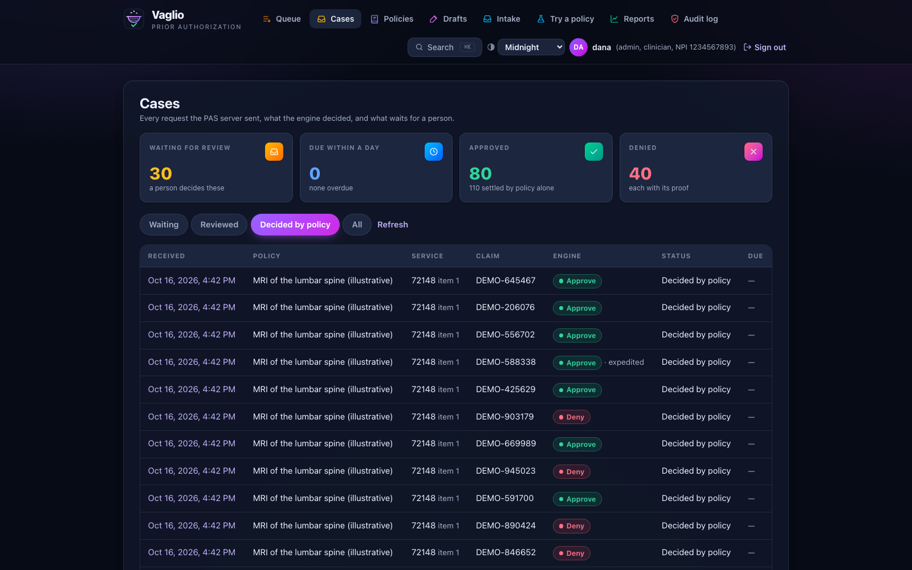
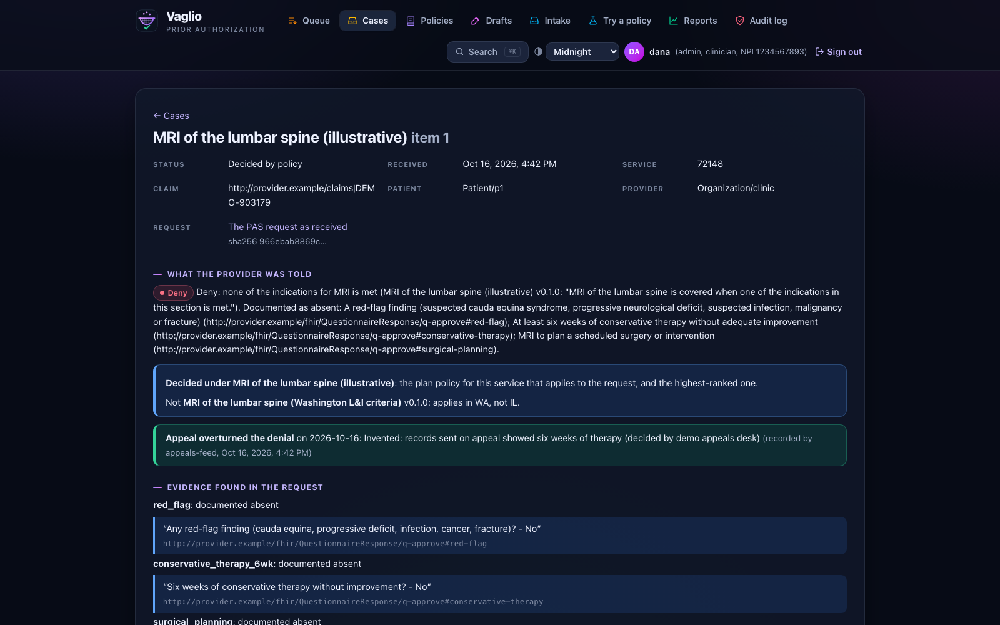
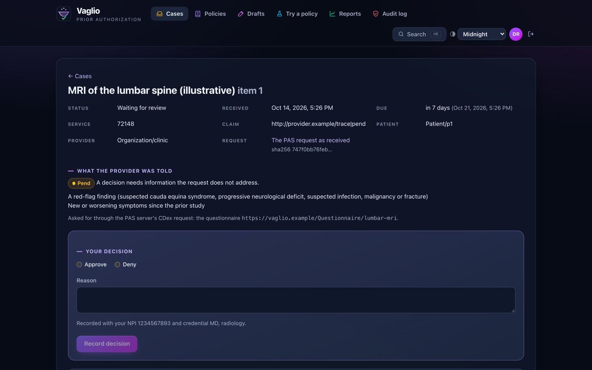
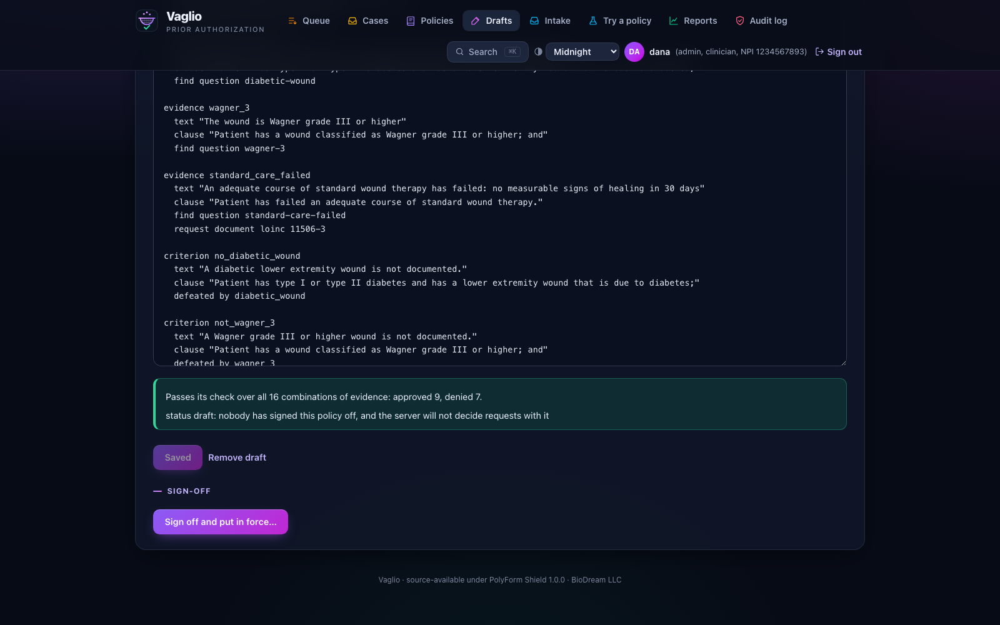
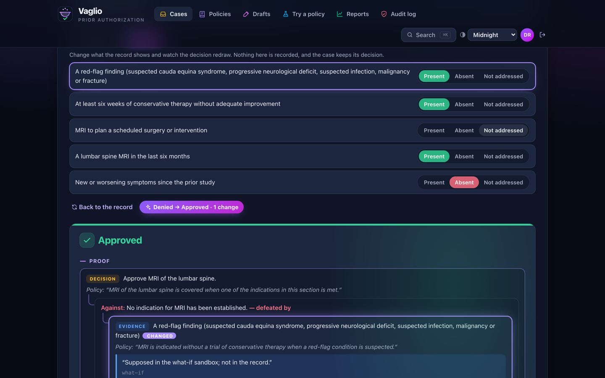
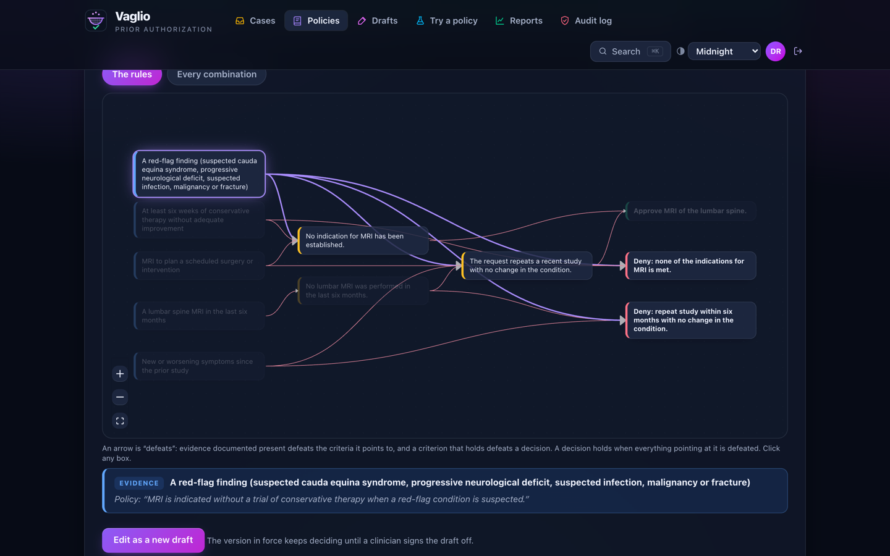
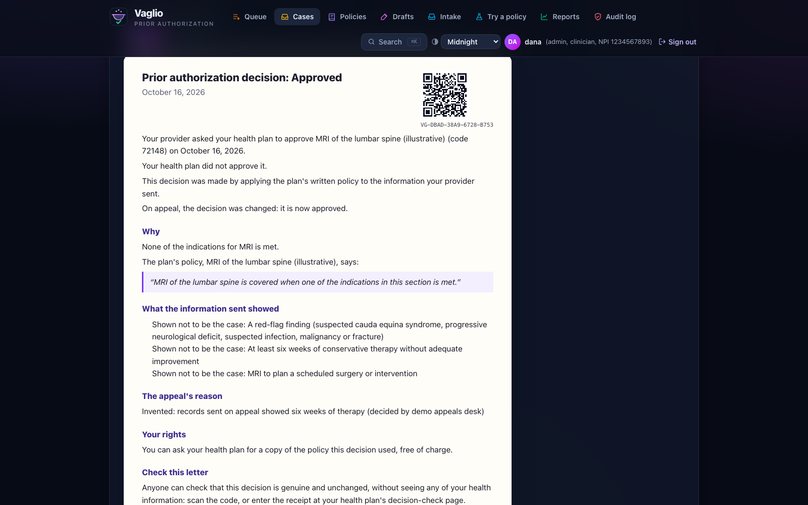
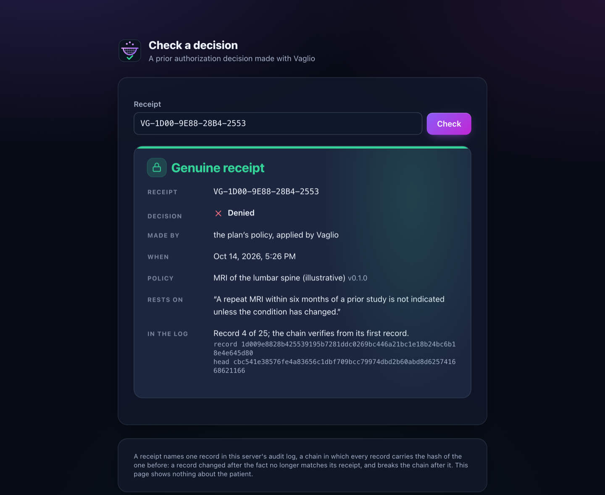
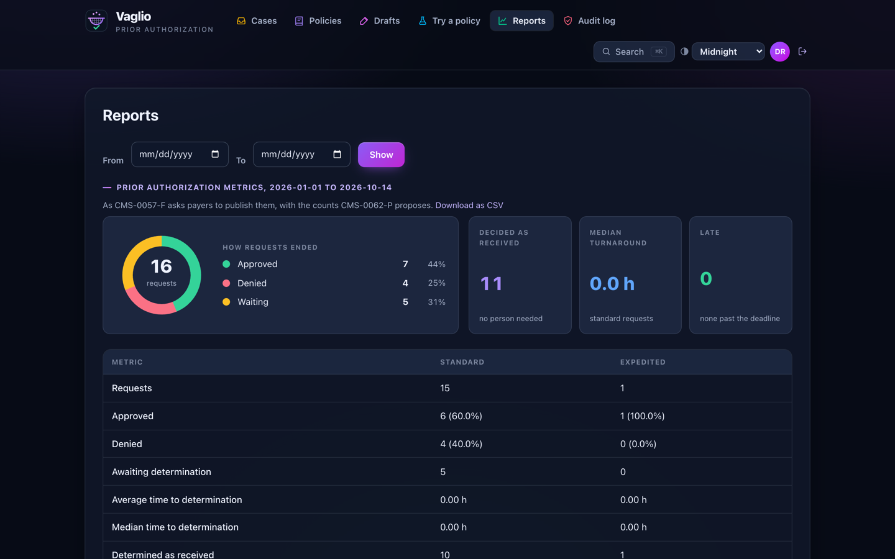

<div align="center">


<h1></h1>

### A prior authorization decision engine that cannot deny care without proving why

**Every answer is a proof.** Each step cites the clause of the plan's policy it applies and the place in the record it
rests on. One rule outranks all the others: **a denial may rest on evidence of absence, never on absence of evidence.**
When anything the record leaves unaddressed could change a denial, the request is pended and that evidence is asked
for by name.

**One 9 MB program. 14 MB of memory at rest.** Its reviewers' console, policy editor, reports and audit log are built
in; it decides Da Vinci PAS requests behind [Perfuse](https://github.com/BioDream-LLC/perfuse) or any PAS server that
calls its decision hook.

[](LICENSE.md) [](https://go.dev) [](#status) [](#build) [](https://github.com/BioDream-LLC/perfuse)

<a href="https://vaglio.perfuse.health:8443"></a>

<sub><b>Sign in as</b> <code>demo</code> <b>with password</b> <code>try-vaglio-demo</code> · invented requests only · look at everything, change nothing</sub>

<a href="docs/Vaglio-overview.pptx"></a>&nbsp;<a href="#build"></a>

<sub>No release yet: build it from source with Go. [What it needs](#build)</sub>

[**Why now**](#why-now) · [**How it compares**](#how-it-compares) · [**What it does**](#everything-it-does) · [**What it looks like**](#what-it-looks-like) · [**Running it**](#running-it) ·
[**Behind Perfuse**](#behind-perfuse) · [**Writing policies**](#writing-policies) · [**Security**](#security) · [**FAQ**](#faq)

</div>

---

## What is Vaglio?

**Vaglio is the decision engine behind a health plan's prior authorization.** A doctor's system asks the plan whether
it will cover a service; the plan's PAS server (its electronic front desk, such as Perfuse) passes the request to
Vaglio; Vaglio reads the evidence in the request, applies the plan's signed policy for that service, and answers:
approve, deny with its proof, or pend and say exactly what is needed.

**It is built for the rules plans now work under.** CMS-0057-F asks most Medicare Advantage, Medicaid, CHIP and
marketplace plans to decide within 7 days (72 hours when urgent), give a specific reason for every denial, take
requests through a standard API, and publish their numbers. Vaglio gives the reason as a proof, keeps the deadline in
front of the reviewer, and builds the published metrics from its own log.

**Policies are short text files that keep the plan's own words.** Each rule quotes its source sentence exactly, and
every policy is tested on every combination of evidence it can be given before it may decide anything. A clinician
signs it off; until then the server refuses it.

**People stay in charge.** Whatever the rules cannot settle goes to a reviewer, with the evidence found, what is
missing and the due date. A plan can require that only a clinician ever denies. Every decision, review, override and
appeal is kept in a tamper-evident log that can be replayed against a new policy before it goes live.



New to prior authorization? **[The slides](docs/Vaglio-overview.pptx)** explain Vaglio in plain words, with no
software background needed.

## Why now

AI now decides prior authorization at scale, and the scrutiny has followed:

- **In court.** In *Estate of Gene B. Lokken v. UnitedHealth Group* (D. Minn.), plaintiffs allege that an algorithm,
  nH Predict, was used to deny Medicare Advantage members post-acute care. On 9 March 2026 the court ordered broad
  discovery into how it works ([order](https://cases.justia.com/federal/district-courts/minnesota/mndce/0:2023cv03514/211721/162/0.pdf)).
- **In the Senate.** In July 2026 Senators Blumenthal and Hawley asked UnitedHealthcare, Humana and CVS for records on
  their use of AI and prior authorization to deny care ([press release](https://www.blumenthal.senate.gov/newsroom/press/release/blumenthal-and-hawley-press-medicare-advantage-insurers-about-refusal-of-care-for-vulnerable-seniors)).
- **In the states.** More than a dozen states, California, Texas, Arizona and Maryland among them, now limit how
  insurers may use AI to deny care, most by requiring a clinician to make or review any adverse determination
  ([KFF](https://www.kff.org/patient-consumer-protections/regulation-of-ai-in-prior-authorization-and-claims-review-a-look-at-federal-and-state-consumer-protections/)).

Each of these asks the same question: *why was this request denied, and can you show it?* Vaglio is built to answer
it:

- **Every decision is a proof** a reviewer, a court or a regulator can read: the plan's clause quoted exactly, the
  place in the record each finding came from, and every step between them. It is kept in a tamper-evident log and can
  be replayed.
- **Missing evidence never denies.** It is asked for by name.
- **Only a clinician denies, when the plan says so.** With `-clinician-denials` the engine never denies on its own: it
  proposes the denial and a clinician makes it, with their NPI and credential recorded. Where a state requires a
  clinician to review AI denials, run it this way. (By default the engine denies on its own only when the record
  documents that a rule is not met.)
- **It runs on the plan's own servers**, and its source is published for anyone to inspect.

## How it compares

Most AI prior authorization for health plans is sold by large companies, often as a service the vendor runs:
[Cohere Health](https://coherehealth.com/decision) (which reports up to 85% of requests approved in real time),
[Optum](https://www.optum.com/en/newsroom/health-tech/optum-is-advancing-ai-powered-digital-prior-authorization.html)
(new AI prior authorization tools for payers and providers since February 2026),
[Availity AuthAI](https://www.availity.com/authai/) and
[EviCore intelliPath](https://www.evicore.com/insights/getting-yes-faster-medical-necessity-reviews). Several describe
their decisions as transparent or explainable. Vaglio's difference is what the explanation is: a proof the engine
itself checks, built from the plan's quoted policy and the cited record, by code anyone can read.

| | Typical AI prior authorization product | Vaglio |
|---|---|---|
| **How it is run** | A product or service from the vendor, often with delegated review | Software the plan runs on its own servers |
| **Why an answer is what it is** | An explanation or rationale, in the vendor's form | A proof per decision: each step cites the clause and the record |
| **Missing evidence** | Handled by each product's own rules | Never supports a denial; asked for by name |
| **Before a policy goes live** | The vendor's validation | Tested on every combination of evidence, signed off by a clinician, replayed over past cases |
| **Medical-necessity criteria** | Often licensed InterQual or MCG | The plan's own policies, public Medicare and Medicaid ones, or the plan's licensed criteria through its own criteria service |
| **Source code** | Closed | Published (PolyForm Shield 1.0.0) |
| **Track record** | Large production deployments | None yet (v0.0.1) |

Around it:

- **Clinical criteria.** [InterQual](https://business.optum.com/en/operations-technology/clinical-decision-support/interqual.html)
  (Optum) and [MCG](https://www.mcg.com/) sell the proprietary criteria most plans decide against. Vaglio does not
  include them and cannot redistribute them. Its library is drafted from public sources, Medicare LCDs and NCDs and
  Medicaid criteria, and a plan can write its own policies in the editor. A plan that licenses criteria can run them as
  a service and cite them in its policies (`find criteria`), so the proof names the licensed criterion and what it found.
- **Provider-side tools** such as Rhyme, Myndshft and Infinitus help providers submit requests. They are on the other
  side of the exchange: Vaglio's answers reach them through the PAS server.
- **Open source.** The HL7 Da Vinci reference implementations
  ([payer server](https://github.com/HL7-DaVinci/br-payer), [prior-auth](https://github.com/HL7-DaVinci/prior-auth),
  [CDS Library](https://github.com/HL7-DaVinci/CDS-Library)) demonstrate the standards; they are not production
  decision engines. We know of no other open or source-available one.
- **Perfuse** is the free, Apache-2.0 standards layer (PAS, X12 278, CDex, subscriptions) that Vaglio sits behind.

What Vaglio does not have yet, plainly: licensed criteria content of its own (a plan brings its licence through a
criteria service), a provider network of its own (it reads the plan's), production sites, and a managed service. It is
software a plan runs, not an outcome a vendor sells.

<sub>Vendor details are from their public pages as of October 2026. Product names are their owners' trademarks.</sub>

## Everything it does

- **Decides PAS requests** for a PAS server such as Perfuse (`POST /api/pas/decide`): reads the request's evidence,
  decides on the policy for the service, and answers approve, deny with its clause and documented absences, or pend with
  what is needed.
- **Keeps every decision as a case**, in a hash-chained audit log the case list is rebuilt from. Pended cases wait in the
  console for a reviewer, whose decision and reason go back to the PAS server as `Claim/$decide`, retried until it lands.
- **Reads evidence from FHIR**, with a citation for every finding: DTR questionnaire answers, Conditions (with the
  verification statuses a clause accepts), completed Procedures (within N days, or lasting N days), and final
  Observations (thresholds in one unit, yes/no, coded values). What it cannot read with confidence is "not addressed",
  the one state that can never support a denial; a record that says both is sent to a person; documents no rule reads
  are listed for the reviewer.
- **Policies in a small language** (`.vaglio`), compiled to the model the engine solves, with errors at line and column,
  `vaglio fmt`, lint warnings, and an exhaustive check over every combination of evidence before a policy may load.
- **Drafts policies from coverage documents** with a language model, behind gates a draft must pass: it compiles, every
  clause is quoted word for word, every code appears in the document, it passes the exhaustive check, and it has no lint
  warnings. What passes is written with `status draft`, which the server refuses until a person signs it off.

- **Makes the DTR questionnaire from the policy** (`vaglio questionnaire`, or the policy screen): exactly the questions
  its decisions read, so the form and the policy cannot drift. `-put` stores it on the PAS server, which serves it to
  DTR apps. The pend report says which missing evidence pends requests most, and whether a question asks for it.
- **Gold carding** (`serve -goldcard FILE`): providers whose recent record under a program (approval rate, look-back
  window, minimum decisions, optionally a state and policies) qualifies are approved without review, with an answer
  naming the program and the record, and the cases counted. Known by NPI only; exempt approvals never count toward the
  next exemption.
- **CMS prior authorization metrics** from the log (`vaglio report metrics`, the Reports screen, CSV): standard and
  expedited, counts and percentages, time to determination. Appeals and extensions are not seen by Vaglio and are
  reported as not tracked, never as zero.
- **Clinician denials** (`serve -clinician-denials`, for California SB 1120 and laws like it): the engine never denies
  on its own. It pends the request and proposes the denial to a reviewer; only an account recorded as a clinician
  (`vaglio user clinician -npi -credential`) may deny, and the decision records their NPI and credential.
- **Replay** (`vaglio replay`, or edit a policy's source in the console): runs a new policy version over every stored
  request it covers and lists the decisions it would change, flagging those that would overrule a reviewer. It changes
  nothing, and is audited.
- **Replay time machine** (each policy's screen): every version of a policy put in force is kept in `DATA/versions` by
  its SHA-256 (at start and at sign-off). Slide across them to see how each would have decided every past request,
  which decisions it would change, and, for any of them, the two proofs side by side. Versions in force before this
  release were not kept; they start with the next start.
- **What if** (every case, in the console): flip any piece of evidence between present, absent and not addressed, and
  the decision and its proof redraw at once, with what changed lit up in the proof. Nothing is recorded; the case keeps
  its decision.
- **Receipts**: every decision (the engine's, a reviewer's, an appeal's) has a receipt such as
  `VG-80C7-1A55-DCF3-C768` and a QR code, made from the hash of its audit record. Anyone holding one checks it at
  `/#/receipt/...` without signing in, or offline against a copy of the log (`vaglio receipt -log FILE CODE`), and sees
  the decision, who made it (engine, reviewer or clinician, never a name), the policy and clause, any later decision on
  the same request, and where it sits in the chain. Nothing about the patient. Checks are limited to 30 a minute per
  address, so the log cannot be swept for receipts. The PAS answer carries the receipt.
- **Policy map** (each policy's screen): the rules as a diagram, evidence on the left, decisions on the right, an arrow
  for each "defeats" (click a box to light up what it touches), and every combination of its evidence as a grid of
  outcomes, neighbouring cells one piece of evidence apart, readable with the arrow keys
  (`GET /api/policies/{id}/map`).
- **Plain-language letters** (each case, in English or Spanish, `GET /api/cases/{id}/letter?lang=en|es`): what was
  asked for, what was decided and by whom, the policy's words it rests on, what the record showed, what is needed or
  what would change it, the patient's rights, and the receipt with its QR code. Written from the decision by fixed
  templates, never by a model, so it says nothing the decision does not. The policy's own words stay in the language
  the plan wrote them in, and the Spanish letter says so: a machine translation of a coverage rule is not the rule. The
  appeal paragraph is generic; a plan's own deadlines and addresses are not in it yet.
- **Draft from a coverage document** (the Drafts screen, `serve -edit-policies -draft-model-url URL [-draft-model M]
  -draft-key-env VAR [-extract pdftotext]`): upload a plan's coverage policy, as text or PDF, and a language model drafts
  it in the policy language, up to six rounds, each held to the drafting gates. You get the draft (saved for an author,
  marked when it does not pass) and what the checker found, sorted: where the draft approves and denies at once, where
  it decides nothing (both may be holes in the document, or misreadings), clauses not quoted word for word, codes the
  document does not list, rules that change nothing. The document goes to the model's provider: published coverage
  documents only, never patient records. A model's drafts often do not pass; the findings are still worth reading.
- **Two readings compared** (`vaglio readings A.vaglio B.vaglio`): two policies drafted from one coverage document,
  each quoting it word for word, decided on every record of their evidence; where they disagree, the groups of records,
  the clauses each rests on, and the simplest example. A check proves a policy consistent, not that it means what the
  document means; a second reading that disagrees is where a person should look. `library/readings/` holds a second
  reading of the TKA LCD.

- **Says what would change it**: every pend and denial carries each smallest set of evidence whose documentation would
  approve it, and says when a route needs the record to be wrong rather than more documentation. The provider is told
  the routes that need only more documentation.
- **Asks for documents the standard way**: evidence can name the LOINC attachment codes that would show it (`request
  document loinc ...`). A pend names them and the questionnaire, and Perfuse asks the provider with a Da Vinci CDex Task
  and CommunicationRequests. What the provider sends back through `$submit-attachment` is fetched into the case, and the
  policy decides again on the request as it now stands, for the reviewer to weigh.
- **Reads attached notes with a model, as proposals** (`serve -document-model-url`): each finding must quote the
  document word for word or it is refused; what passes is nothing until a reviewer confirms it, and a confirmed finding
  is evidence cited to the document and the words. Documents are patient records, so the model must be on this machine
  unless `-document-model-remote` says the provider is covered by a business associate agreement.
- **Drug prior authorization**: `drug` policies, `find medication rxnorm ... within N days lasting N days` over
  MedicationDispenses and MedicationStatements (days of supply summed across fills, for step therapy), counted apart in
  the CMS metrics. `policies/adalimumab_ra.vaglio` is an illustrative step-therapy policy.
- **Override and appeal analytics** (`vaglio report overrides -by clause|provider|state`, the Reports screen): how often
  the engine's denials were approved by a clinician instead, or overturned on appeal (`POST /api/cases/{id}/appeal`
  records an appeal's outcome). Approved-after-appeal is now in the metrics.
- **Which services still need prior authorization** (`vaglio report list`, the Reports screen, CSV): health plans have
  committed to require prior authorization for fewer services. Per service, how often requests were approved in the end
  (by the engine, a reviewer, a gold card or on appeal), how many at once, how often the engine's denials were reversed,
  and the median time a person took. Each service gets a verdict by thresholds the plan sets and the report states
  (`-min-requests`, `-min-approved`, `-min-reversed`; 30 requests, 95% approved, half of any denials reversed by
  default): consider removing (review rarely changes the answer, and is mostly wrong when it does), keep, or not enough
  requests. It recommends and changes nothing; services no policy here decides are not seen.
- **Fairness** (`vaglio report fairness`, the Reports screen for reviewers): whether the engine's errors fall harder on
  some patients. Approval rates differ between groups for good reasons (criteria treat ages differently on purpose), so
  the measure is error, as in the method published as arXiv:2603.14631: of the engine's denials, how many a clinician or
  an appeal reversed, and how often requests were pended to ask for more, by sex, age band, race and ethnicity (US Core),
  state and line of business. A group that differs from the rest beyond chance (two-sided Fisher exact test, p < 0.01) is
  flagged, in words, as a place to read cases, not a finding. The engine reads no demographics, so a difference comes
  from the records sent, reviewers or appeals. Demographics are read from the stored requests when the report is made,
  never copied into cases; groups under 11 requests are not shown; making the report is in the audit log. Income and
  disability are not in a prior authorization request and are not reported.
- **Several plans on one server** (`serve -plans FILE`, for a utilization management organization): each plan at its own
  hostname with its own policies, data, audit chain, accounts, tokens and PAS server; nothing of one is reachable from
  another. See [Running it](#several-health-plans-on-one-server).
- **Requests by fax, phone, mail or portal** (the Intake screen; `serve -fax-token-env VAR` for the fax inbox): the plan's
  fax service posts each fax to `/api/feeds/fax` with its bearer token; Vaglio keeps it, makes its text with `-extract`
  when it can, and lists it in the inbox. A person opens it beside a form, keys in the patient, coverage, provider and
  service, and answers the policy's own questions as the request shows them: yes, no, or not shown. It is then one more
  PAS request: the same policy choice, evidence, proof, case, receipt and audit record, with the fax kept in the request
  as a DocumentReference for the reviewer and the document reader. The case names its channel and who keyed it in, and
  its answers are cited as their reading. "Not shown" is not addressed, so a request keyed in with gaps pends and asks
  for them. No PAS server waits for these decisions: the provider is sent the letter. Calls and letters are keyed in the
  same way. An account needs the reviewer role or the `intake` scope; a fax not to key in is set aside with a reason.
- **A policy library** (`library/`): policies drafted from published coverage documents, each held by a test to the
  drafting gates against its source, which is kept beside it with where and when it was retrieved. All are drafts until
  a clinician signs them off. The AHIP/BCBSA standard documentation set for 66 services is not public (only its
  categories are), so the library is built from public documents:

  | Policy | Basis | Category |
  |---|---|---|
  | `cpap_osa` | Medicare LCD L33718 (E0601) | DME: sleep |
  | `tka` | Medicare LCD L36575, total knee arthroplasty (27447) | Musculoskeletal |
  | `facet_rfa` | Medicare LCD L38773, facet joint radiofrequency ablation (64633-64636) | Musculoskeletal: spine |
  | `ccta` | Medicare LCD L35121, coronary CT angiography (75574) | Advanced imaging: cardiac |
  | `lumbar_mri_wa` | Washington L&I lumbar spine MRI guideline (72148, 72149, 72158) | Advanced imaging: spine |
  | `bariatric_ncd` | Medicare NCD 100.1 and Claims Processing Manual ch. 32 | Surgery: bariatric |
  | `adalimumab_ra_ut` | Utah Medicaid adalimumab criteria, RA (J0135, step therapy) | Drugs: specialty |

  The last three are the sourced counterparts of the illustrative policies in `policies/`. Each policy's header says
  which readings of its source a clinician should confirm.
- **A policy editor in the console** (`serve -edit-policies`): drafts are written and checked as they are typed (parse
  errors jump to the line; the exhaustive check and lint run beside it), saved to `-policies/drafts/`, and signed off by
  a clinician's account - the signature is the account's name and credential, never typed. A signed policy is in force
  at once (or on its effective date), replacing its earlier version, which keeps deciding until then. Sign-off refuses a
  draft that fails its check, has warnings, reuses the version in force, or ties with another policy for a service. Every save and sign-off is in the audit
  log by the source's SHA-256.
- **Effective dates and which policy wins** (`effective`, `ends`, `authority ncd|lcd|state|plan`, `lines`, `states` in a
  policy's header): a policy signed off before its effective date waits in `-policies/scheduled/`, and the version it
  replaces keeps deciding until the first request of that day, which the audit log records. When several policies are
  for one service, the one deciding a request is in effect that day, covers the member's line of business (from the
  request's Coverage type) and the patient's state, and has the highest authority: a national coverage determination
  over a local one or a state's criteria, over the plan's own policy. The case says why that one, and why not each of
  the others. Two policies of one rank that could both reach a request are refused at load and at sign-off, so the
  choice is never a tie. When a higher policy may apply but the request does not say (no Coverage type, no address), the
  lower one may approve, never deny: the request is pended and the missing coverage or address asked for.
- **Richer date rules**: `find condition ... onset at least N days` (how long a condition has lasted), and
  `find procedure ... within N days times N apart N days` (two blocks at least 14 days apart; two RFA sessions in a
  year). Fewer procedures, or ones that cannot be dated apart, document nothing either way.
- **Evidence from outside the request**: a criteria service the plan runs or licenses (`find criteria NAME CRITERION`,
  `serve -criteria NAME=URL [-criteria-token-env NAME=VAR]`), the plan's provider network (`find provider in-network`,
  `serve -network npis.csv`), and providers' specialties from the federal NPI registry (`find provider specialty
  207X00000X`, `serve -npi-registry nppes` for the public API, which is sent only the provider's NPI and kept for a day,
  or a CSV extract of its download). Each finding is cited in the proof like the record's own: the criterion and the
  service's reason, the network file and its date, the registry's listing. Every source fails safe: no answer in five
  seconds, an error, "unknown", or an NPI the registry does not know is not addressed, which never denies; a "not met"
  without its reason is not used. A policy naming a source the server lacks is refused at start. A stored case is
  decided again (replays, confirmed readings) on what the sources said then, not asked again. The criteria service is
  sent `{"criterion", "policy", "policyVersion", "service", "bundle"}` and answers `{"result": "met" | "not-met" |
  "unknown", "reason", "reference"}`.
- **Reading documents at scale** (`serve -read-documents`, with `-document-model-url`): a pended request's documents,
  and those received later, are read as soon as it pends, by a pool of workers (`-read-workers`, 2 by default), so a
  reviewer opens the case with the proposals waiting. With `-approve-from-documents`, a request the policy approves on
  the readings' findings, each quoted word for word from its document, is approved with no person, sent to the PAS
  server, and its letter and receipt say the plan's policy was applied to the documents. Only approvals: a reading that
  would deny or pend changes nothing, and a denial proposed to a clinician still waits for one. `-approve-sample`
  (10% by default) sets automatic approvals aside for a reviewer to check after the fact; the Reports screen counts the
  checks and the disagreements, which is what says whether to keep it on.
- **PDFs and scans for the document reader** (`serve -extract pdftotext,tesseract`): local programs make the text, which
  goes through the same quote gate. The case marks such documents, and the reviewer confirms against the original,
  served as a sandboxed download.
- **Narrower roles** (`vaglio user scopes`): `author` (write drafts), `audit` (read the log), `appeals` (record appeal
  outcomes), `intake` (key in faxed and phoned requests), `policy:ID` (see and decide only that policy's cases; other
  cases are not found). Changing an account's scopes ends its sessions.
- **Single sign-on** (OpenID Connect, `serve -oidc-issuer ...`): code flow with PKCE, the ID token verified against the
  provider's keys (RSA or ECDSA; `none` and HMAC refused), with issuer, audience, expiry and nonce checked, and
  optionally a required group. The provider says who someone is; an account made with `vaglio user sso` says what they
  may do. A name with no such account is refused, never created.
- **Decision timeframe extensions** (`POST /api/cases/{id}/extend`): 7 days standard and 72 hours expedited (CMS-0057-F),
  72 and 24 hours for drugs; a reviewer may extend once, by up to 14 days (`-extension-days`), for one of the three
  reasons 42 CFR 422.568(b)(2) allows, with what the enrollee is told, before the deadline, never for a drug. The queue
  shows what is due and overdue; the metrics count extensions, approvals after one, and late determinations.
- **An appeals feed** (`POST /api/feeds/appeals`, bearer token from `-appeals-token-env`): the appeals system sends
  outcomes, matched to the denial by Claim identifier and item, recorded once by their reference.
  `vaglio appeals import FILE.csv` sends a CSV export through it.

## Status

**v0.0.1: early, and not yet in production anywhere.** Everything above is built and tested (157 Go test functions, the
console's tests, and every policy checked on every combination of evidence), and the whole path has been run end to end
through a real Perfuse. The policies in `policies/` are **illustrative only**: not any payer's policy and not clinical
guidance.

How the code is laid out:

- `internal/af`: Dung framework, grounded labelling, defenders by round. Cross-checked against the definition (the
  intersection of all complete extensions) on 600 random frameworks.
- `internal/policy`: the model, the language (`lang.go`), and lint.
- `internal/decide`: decisions, proofs, the absence rule, contradictory records, and `Check`. The absence rule is tested
  by brute force over all 3^5 requests to the example policy.
- `internal/evidence`: PAS request Bundle in, cited findings out, through Perfuse's published `pas` and `fhir` packages.
- `internal/audit`, `internal/cases`, `internal/deliver`: the log, the cases derived from it, delivery to `Claim/$decide`.
- `internal/auth`: accounts and sessions. `internal/draft`: the drafting loop and its gates.
- `internal/editor`: drafts, sign-off and putting a policy in force. `internal/oidc`: single sign-on.
- `internal/dtr`, `internal/goldcard`, `internal/report`, `internal/replay`: questionnaires, exemptions, metrics, pend
  causes and reversals, replays. `internal/reader`: documents read by a model behind the quote gate.
- `internal/tlsserve`, `internal/acme`: https only, Vaglio's own authority, and Let's Encrypt (RFC 8555, http-01 and
  tls-alpn-01), tested against Pebble, Let's Encrypt's own test authority.
- `internal/receipt`, `internal/letter`, `internal/versions`, `internal/readings`: receipts checked against the log,
  plain-language letters, the kept policy versions, and two readings of one document compared.
- `internal/precedence`: which policy decides when several are for one service (dates, lines, states, authority).
- `internal/intake`: requests keyed in from a fax, a call, a letter or a portal, and the fax inbox.
- `internal/outside`: criteria services, the provider network and the NPI registry. `internal/fairness`: error rates
  by group, with Fisher's exact test.
- `deploy/demo/`: how the public demonstration at vaglio.perfuse.health:8443 is run.
- `library/`: drafted policies, their sources and `library.json`; `library/drafts/` keeps the machine's own drafts.
- `internal/server` + `web/`: the API and the React/Redux console (cases and review, policies and their check, trying a
  policy by hand, the audit log), embedded in the binary.
- `testdata/pas/`: synthetic PAS requests, run through a real Perfuse during development and pinned by a test.
  `testdata/drafts/`: a policy the drafting loop produced from `testdata/documents/`, pinned the same way.

Not yet: notices to the enrollee are the plan's (Vaglio records an extension's reason; it does not mail it); single
sign-on is tested against a test provider only, not a real one; Let's Encrypt is tested against Pebble, its test
authority, not yet against Let's Encrypt itself; reading scanned images needs `tesseract` installed;
there is no release build yet; the letters' appeal paragraph is generic, not a plan's own deadlines and addresses;
advice before submitting shows in Perfuse only from its `crd-advisor` branch, not yet merged. The criteria-service
protocol is Vaglio's own: no licensed criteria vendor is known to speak it yet, so a plan's licence needs a small adapter.
Automatic approval from documents is tested with a stand-in model only; how often a real model's approvals survive the
checks is what the sampled checks will show. Faxes arrive by a fax service's webhook; there is no fax line or modem
support. Several plans on one server cannot use single sign-on yet.


## Try it

A public demonstration runs at **https://vaglio.perfuse.health:8443**, on invented requests only: sign in as `demo` with
`try-vaglio-demo` (a viewer: it can look at everything and change nothing). An invented lumbar spine MRI request
arrives every 20 minutes, and the log starts again every night. Open a case and try the what-if sandbox, read its
letter in English or Spanish, check its receipt, and look at the policy map. How it is run is in `deploy/demo/`.

## What it looks like

<table>
<tr>
<td width="50%"><br><sub><b>The queue.</b> Waiting cases with what the engine said and how long each has left.</sub></td>
<td width="50%"><br><sub><b>A denial with its proof.</b> The clause quoted, the absences documented, each finding cited to the record.</sub></td>
</tr>
<tr>
<td width="50%"><br><sub><b>A pend.</b> What is needed, how it was asked for, the deadline, and the reviewer's decision.</sub></td>
<td width="50%"><br><sub><b>The policy editor.</b> Checked on every combination as it is written; a clinician signs it into force.</sub></td>
</tr>
<tr>
<td width="50%"><br><sub><b>What if.</b> Flip any evidence and the decision and its proof redraw, with the change lit up.</sub></td>
<td width="50%"><br><sub><b>The policy map.</b> The rules as a diagram, and every combination of evidence as a grid.</sub></td>
</tr>
<tr>
<td width="50%"><br><sub><b>The letter.</b> Written from the decision by template, in English or Spanish, with its receipt.</sub></td>
<td width="50%"><br><sub><b>Check a receipt.</b> Anyone can, without signing in and without seeing the patient.</sub></td>
</tr>
<tr>
<td colspan="2"><br><sub><b>Reports.</b> The CMS prior authorization metrics, from the log, on screen or as CSV.</sub></td>
</tr>
</table>

<sub>Screens from a test server with synthetic requests and the illustrative policies.</sub>

## Running it

```
vaglio serve -data data -policies policies -token-env VAGLIO_TOKEN \
  -pas-url https://perfuse.plan.internal/fhir -pas-token-env PERFUSE_TOKEN
```

It answers on **https only**, on every address, this machine's included; a plain-http request gets a redirect to
https and nothing else. The first start creates an `admin` account and prints its password once. Add people from the command line, while the
server runs or not:

```
vaglio user add -data data -role reviewer dr.lee     # prints a generated password, once
vaglio user reset -data data dr.lee                  # a new password
vaglio user remove -data data dr.lee
vaglio user clinician -data data -npi 1234567893 -credential "MD, radiology" dr.lee
vaglio audit verify -data data                       # check the chain; keep the hash it prints somewhere else
vaglio report metrics -data data -from 2026-01-01 -csv
vaglio report pends -data data -policies policies
vaglio goldcard -data data -config goldcard.json     # every provider's standing
```

A gold card file:

```
{"programs": [{"name": "Texas gold card", "basis": "Tex. Ins. Code ch. 4201, subch. N", "states": ["TX"],
  "minApprovalRate": 0.9, "lookBackDays": 180, "minDecisions": 5}]}
```

Check the numbers against the law you apply; the example's are illustrative. `"count"` says which decisions make a
provider's record for a program with states: `"all"` (the default) counts every decision for the policy wherever the
patient lives, `"states"` only those for patients in the program's states. An administrator can switch it on the
Reports screen; the switch is recorded in the audit log and survives a restart. A state rule is matched on the patient's
address, the closest a PAS request comes to the plan's state.

Roles: **viewer** reads cases and policies; **reviewer** also decides pended cases; **admin** also reads the audit log.
Sessions end after 30 minutes idle or 12 hours, and on a restart. Five wrong passwords lock a name for 15 minutes.

`data/` holds the audit log, the request Bundles (patient data) and the accounts. The server refuses to use it unless only
its owner can read it. Back it up as a whole: the cases are the log.

### Several health plans on one server

A utilization management organization deciding for several plans runs one server with `-plans plans.json`:

```
{"plans": [
  {"id": "acme", "name": "Acme Health", "hostname": "acme.pa.example", "policies": "/srv/acme/policies",
   "tokenEnv": "ACME_PAS_TOKEN", "pasUrl": "https://perfuse.acme.example/fhir", "pasTokenEnv": "ACME_PERFUSE_TOKEN"},
  {"id": "blue", "name": "Blue Plan", "hostname": "blue.pa.example", "policies": "/srv/blue/policies",
   "tokenEnv": "BLUE_PAS_TOKEN", "faxTokenEnv": "BLUE_FAX_TOKEN", "clinicianDenials": true}
]}
```

Each plan is reached at its own hostname and is wholly its own: its policies, its data directory (`-data/plans/<id>` unless
`data` says where) with its own audit chain, cases, accounts and sessions, its own PAS token, PAS server, gold card file,
fax inbox and appeals feed, and whether only clinicians deny. A session or a token of one plan opens nothing at another,
a Host header no plan has is refused, and the file is refused if two plans share an id, hostname, data or policy
directory, or token variable. The certificate covers every plan's hostname (Vaglio's own authority, or `-acme` for all
of them). Reports and `vaglio user`, `report` and `audit` commands take each plan's data directory. Single sign-on and
the demonstration account are for a one-plan server.

### Its certificate

Two ways, and the first is what production should use:

- **The plan's own certificate.** IT issues one from the plan's internal certificate authority (which its computers
  already trust) or a public one, and Vaglio serves it: `-tls-cert server.crt -tls-key server.key -hostname
  vaglio.plan.internal`. A renewed file is picked up without a restart.
- **Let's Encrypt, built in.** For a server the internet can reach by name: `-acme -hostname vaglio.plan.example
  -acme-email it@plan.example`. Vaglio gets the certificate itself, keeps it in `data/tls/acme`, and renews it 30 days
  before it runs out, with no restart and nothing else installed. Let's Encrypt checks the name on port 80 (http-01;
  the rest of port 80 redirects to https, for that name only) or, when Vaglio itself is on 443, on 443 (tls-alpn-01,
  with `-acme-http-port 0` to leave port 80 closed). Until the first certificate arrives, and if Let's Encrypt cannot be
  reached at renewal, Vaglio's own authority's certificate serves, so the console is never without https.
  `-acme-directory` names another ACME authority (the plan's own, or Let's Encrypt's staging directory to try it), and
  `-acme-ca` the authority to trust for it.
- **Vaglio's own authority, the default.** With no `-tls-cert`, the first start makes a small certificate authority in
  `data/tls` and issues the server's certificate from it, renewing it before it runs out. Browsers warn until a computer
  trusts `data/tls/ca.crt` once (or IT pushes it to every computer); after that, never again, renewals included.
  `vaglio tls show -data data` prints its SHA-256, to compare before trusting it, and the command for macOS, Windows,
  Linux and Firefox. It is not a bare self-signed certificate, and it can vouch only for this server: the authority is
  name-constrained to `localhost`, the loopback addresses and `-hostname`, so a computer that trusts it (or anyone who
  stole its key) gains no power to impersonate another site. Change `-hostname` and it makes a new authority, keeping
  the old file.

A load balancer or proxy in front (an AWS load balancer, nginx) can show browsers a public certificate and speak https
to Vaglio behind it, trusting `data/tls/ca.crt`. TLS 1.2 is the minimum, and HSTS is sent.

Clients that call Vaglio name its authority when it is Vaglio's own: `vaglio appeals import -ca data/tls/ca.crt`,
Perfuse's `-pas-decider-ca`. Vaglio trusts a private authority for Perfuse with `-pas-ca FILE`.

## Behind Perfuse

Perfuse's PAS server asks Vaglio about every item its rules file leaves to a reviewer:

```
perfuse serve -fhir -pas -crd-rules rules.yaml \
  -pas-decider-url https://127.0.0.1:8740/api/pas/decide -pas-decider-token-env VAGLIO_TOKEN \
  -pas-decider-ca /path/to/vaglio/data/tls/ca.crt
```

`-pas-decider-ca` is needed only while Vaglio uses its own authority (and needs a Perfuse built from `main` until the
next Perfuse release).

Perfuse sends the Bundle with `X-PAS-Request-Id`, the ClaimResponse id; Vaglio answers Perfuse's protocol (`decision`,
`why`, `requested`) plus the case id, the proof and the evidence. A service no policy decides is a `404`, which leaves
Perfuse's answer standing. Perfuse pends on any failure, and Vaglio refuses to answer a decision it could not record.
With `-pas-url`, a reviewer's decision is sent back as `Claim/$decide` under that id, and the provider's subscription
delivers it. A Perfuse API token with the editor role is what `-pas-token-env` names.

**Before a request is sent.** `POST /api/pas/advise` (the same bearer token) takes an order's service code and the
record a coverage requirements (CRD) service has for it, and answers what a request would be told as the record stands:
would be approved, would wait for these pieces of evidence (and the questionnaire that asks), or would not be approved and
what would change that. It opens no case and decides nothing; the request that follows is decided on its own. Perfuse
shows it as one more CRD card with `-crd-advisor-url https://.../api/pas/advise` (on its `crd-advisor` branch until that
is merged). Perfuse never needs Vaglio: with no answer, the cards are what its rules say.

## Speed

Measured with `vaglio bench` (temporary data, invented lumbar MRI requests; run it on your own hardware), October 2026:

| | Apple M4, 16 GB, internal SSD | Amazon Lightsail nano, 2 vCPUs (burstable), 512 MB, about $5 a month |
|---|---|---|
| Engine alone, one core | 53,000 decisions/s (19 µs each) | 26,000 decisions/s (38 µs each) |
| Whole PAS requests, one at a time | 213/s; p50 4.0 ms, p99 11 ms | 251/s; p50 3.5 ms, p99 6.9 ms |
| Whole PAS requests, all cores busy | 196/s; p50 51 ms, p99 74 ms (10 in flight) | 258/s; p50 6.9 ms, p99 13 ms (2 in flight) |

The engine's figure is a decision with its full proof and every route to approval. A whole request reads the PAS Bundle,
finds the evidence, decides, writes the case to the audit log and syncs it to disk before answering, so the disk's sync
time, not the engine, sets the pace: one decision at a time in the log, by design. Not included: TLS, the network and
the PAS server in front. For scale, 250 requests a second is over 20 million a day.

## Security

- `/api/pas/` takes the bearer token from `-token-env`. Everything else takes a session cookie (HttpOnly,
  SameSite=Strict), and every state-changing request must be JSON from this origin.
- https only, everywhere (TLS 1.2 or later, HSTS). A plain-http request is redirected only to a name the server
  answers to, and a plain-http POST is refused, never redirected. Off loopback the server requires `-hostname` and
  refuses any other Host header. `-pas-url` must be https, or plain http to this machine only.
- Reading a case is audited, as is every decision, review, sign-in, failed sign-in and change of account.
- The audit log is tamper-evident, not tamper-proof: an edit, deletion or reordering is detected and the server will not
  start on it, but whoever can rewrite the whole file can rewrite it consistently. Keeping the hash `vaglio audit verify`
  prints somewhere else closes that for the log up to that point.
- The log needs a file lock, so it runs on Linux and macOS; a Windows build refuses to write it.
- `/api/feeds/appeals` takes only its own bearer token, and is off unless `-appeals-token-env` is set.
- Single sign-on needs https for the provider and the callback (plain http only to this machine). The sign-in state is
  bound to the browser that started it, good once, and expires in 10 minutes; every refused sign-in is logged.
- Extractors run with no shell, a near-empty environment, a time limit and bounded output; the document stays on this
  machine.
- `vaglio draft` sends the document to the model's provider: use it for published coverage policies only, never anything
  with patient data in it.

## Writing policies

```
vaglio check policies/*.vaglio                 # every combination of evidence, plus warnings
vaglio fmt policies/*.vaglio                   # the standard layout (comments at the top are kept)
vaglio compile policies/lumbar_mri.vaglio      # the JSON the engine reads
vaglio draft -id knee -out knee.vaglio document.txt    # OpenRouter by default: -url, -model, -key-env
bin/vaglio decide -policy policies/lumbar_mri.vaglio testdata/requests/repeat_mri_unaddressed.json
```

The language is described at the top of `internal/policy/lang.go`; `policies/` has two worked examples.

## Build

Needs Go 1.27 (Perfuse's published `fhir` and `pas` packages come from Perfuse v0.1.15), and Node 20 or later only to
rebuild the console (`internal/web/dist` is committed, so `go build` works without it). Runs on Linux and macOS; the
audit log needs a file lock, so a Windows build refuses to write it.

```
git clone https://github.com/BioDream-LLC/vaglio && cd vaglio
make check      # gofmt, vet, go test -race, typecheck, vitest, policy check; prints CHECK PASSED
make build      # bin/vaglio, static, CGO_ENABLED=0
make web        # rebuild the console into internal/web/dist
```

`pdftotext` (poppler) and `tesseract` are optional: `serve -extract` uses them to read PDFs and scans.

## FAQ

<details>
<summary><b>Is Vaglio free? What is the licence?</b></summary>

Vaglio is **source-available** under the [PolyForm Shield License 1.0.0](LICENSE.md). You may read, run, change and
share it at no cost, including as a health plan deciding its own prior authorization requests. What the licence does
not allow is using Vaglio to provide a product that competes with it, such as selling it, or a service built on it,
as a prior authorization decision engine. For that, ask BioDream LLC for a commercial licence. It is not "open
source" in the OSI sense, and we do not call it that. [Perfuse](https://github.com/BioDream-LLC/perfuse), which it
works with, is Apache-2.0 open source.

</details>

<details>
<summary><b>Do I need Perfuse?</b></summary>

To receive requests from providers you need a PAS server in front of Vaglio, and Perfuse is the one it is built and
tested with: free, Apache-2.0, and one program like Vaglio. Any PAS server that calls the decision hook
(`POST /api/pas/decide`, described in [Behind Perfuse](#behind-perfuse)) can be used instead. Without a PAS server,
Vaglio still runs on its own for writing and trying policies, reviewing, reports and replay. Perfuse never needs
Vaglio.

</details>

<details>
<summary><b>Can Vaglio deny a request on its own?</b></summary>

Only when the record shows the patient does not meet a rule, and only with a proof that quotes the rule and cites
the record. A missing or unclear fact never supports a denial: the request is pended and the fact is asked for. A plan
can go further with `-clinician-denials`: the engine then never denies at all, and proposes the denial to a clinician,
whose NPI and credential the decision records.

</details>

<details>
<summary><b>Are the policies in the library ready to use?</b></summary>

They are drafts. Each is drafted from a public coverage document kept beside it and quoted word for word, and passes
every gate, but a plan's own medical director must read each one against its source and sign it off before it decides
anything. The server refuses an unsigned policy. The policies in `policies/` are illustrative only.

</details>

<details>
<summary><b>Does patient data leave the plan?</b></summary>

No. Vaglio runs on the plan's own servers and sends nothing to BioDream. Reading attached notes with a language model
needs a model on the same machine, unless `-document-model-remote` states that the provider is covered by a business
associate agreement. Drafting policies with a model uses published coverage documents only.

</details>

<details>
<summary><b>Why is it called Vaglio?</b></summary>

*Vaglio* is Italian for a sieve, and for careful scrutiny: what passes has been examined. It is the idea of the
engine, and its logo.

</details>

## Contributions are not accepted

Vaglio is developed and maintained by BioDream LLC, and it stays that way. **Pull requests will not be reviewed or
merged.** There is no contributor agreement to sign because there is no route for a contribution to arrive. This
software decides whether patients get care, and the discipline that makes it worth trusting (every denial proven,
every policy checked on every case, anything uncertain refused rather than guessed) is easy to state and slow to
enforce across contributors.

**Bug reports are wanted.** [Open an issue](https://github.com/BioDream-LLC/vaglio/issues) with the output of
`vaglio version` and, if a request is involved, a synthetic or fully de-identified one. Never post patient data.

**Security problems:** please report them privately through this repository's Security tab ("Report a
vulnerability"), not in a public issue.

## Licence

[PolyForm Shield License 1.0.0](LICENSE.md). Copyright 2026 BioDream LLC. See [NOTICE](NOTICE).

Vaglio includes the `fhir` and `pas` packages of Perfuse, a separate project under the Apache License 2.0, whose
licence and notice are in [licenses/](licenses). The coverage documents in `library/sources/` belong to their
publishers (CMS and state agencies) and are quoted as the basis of each policy.

Vaglio is not affiliated with or endorsed by CMS, HL7, the Da Vinci Project, AHIP, BCBSA, or any company named in this README. HL7 and FHIR are
registered trademarks of Health Level Seven International, used only to say what Vaglio reads and writes. The
policies here are not medical advice and not any health plan's coverage policy.

<div align="center">

<details>
<summary><b>Keywords</b></summary>

<sub><b>Prior authorization:</b> prior authorization engine · utilization management · medical necessity · coverage policy · decision engine · prior auth automation · step therapy · drug prior authorization · gold carding · clinician review · appeals · peer review</sub><br><br>
<sub><b>Standards and rules:</b> CMS-0057-F · CMS-0062-P · Da Vinci PAS · Da Vinci DTR · Da Vinci CDex · FHIR R4 · X12 278 · Questionnaire · Medicare LCD · NCD · SB 1120 · Texas gold card · 42 CFR 422.568</sub><br><br>
<sub><b>Engine:</b> explainable decisions · argumentation · grounded semantics · proofs · evidence citation · exhaustive policy testing · audit log · hash chain · policy replay · Go · single binary · OpenID Connect · Perfuse</sub>
</details>

</div>
